# Rapport final – Projet fil rouge CI/CD SouverainRecrut

**Mastère Expert en Développement et Déploiement de Solutions Numériques Sécurisées – RNCP 40166**
Module CI/CD – Sup de Vinci Rennes – Formateur : Alimou Diallo

> **Version de travail.** Partie 1 (intégration continue) terminée. Partie 2 : serveur, Terraform,
> Ansible et Docker Compose réalisés et testés ; exécution du pipeline GitLab et test de rollback
> marqués *[à compléter]*.

---

## 1. Contexte et objectifs

SouverainRecrut est une application de gestion de recrutement. Le projet consiste à industrialiser
le cycle de vie de son **API Backend** (Node.js 22, Express, TypeScript, Prisma, PostgreSQL), le
Frontend étant hors périmètre.

Objectif : construire une chaîne de livraison **automatisée, reproductible, sécurisée, traçable et
documentée**, depuis un commit jusqu'à une API déployée :

1. **Intégration continue** – le code est testé et analysé, une image Docker est construite, scannée
   et publiée sur Docker Hub (Jenkins, SonarQube, Trivy).
2. **Déploiement** – l'image publiée est récupérée par un pipeline GitLab CI/CD et déployée sur un
   serveur Ubuntu préparé avec Ansible et Terraform.

## 2. Démarche

La progression suit le cours : **Manuel → Scripté → Automatisé**.

| Étape | Manuel (comprendre) | Automatisé (industrialiser) |
|---|---|---|
| Tests | `npm run test:coverage` en local | étape *Tests* du Jenkinsfile |
| Qualité | scanner Sonar lancé à la main dans un conteneur | `withSonarQubeEnv` + `waitForQualityGate` |
| Image | `docker build` / `docker run` / scan Trivy en local | étapes *Build image*, *Trivy scan*, *Push* |

Chaque étape a été validée manuellement avant d'être automatisée, ce qui a permis de détecter les
problèmes (route `/v1`, hotspot, vulnérabilités, mémoire) avant qu'ils ne bloquent la pipeline.

Un journal de bord a été tenu tout au long du projet (commandes, résultats, incidents) ; il sert de
base à ce rapport.

## 3. Partie 1 – Intégration continue

### 3.1 Préparation du dépôt
Fork du dépôt officiel, clone, branche `Dev`, `npm ci` (installation reproductible à partir du
lockfile) et `npx prisma generate`.

Constats sur le dépôt fourni : script `test` factice, Dockerfile en Node 20 et exécuté en root,
absence de `.dockerignore`.

### 3.2 Tests Backend
- **Outils** : Jest 30 + ts-jest (TypeScript), Supertest (requêtes HTTP sans ouvrir de port),
  jest-junit (rapport lisible par Jenkins).
- **Isolation** : un faux client Prisma (`jest.mock`) remplace la base ; les tests passent par les
  vraies routes, donc par les middlewares d'authentification, de rôles et de validation.
  Ils s'exécutent sans PostgreSQL, en local comme dans Jenkins.
- **Configuration dédiée** : `tsconfig.test.json` (le `tsconfig.json` de production limite la
  compilation à `src/`), dossier `tests/` hors de l'image Docker.
- **Couverture fonctionnelle** : authentification, gestion des candidats, offres, candidatures,
  utilisateurs, contrôle d'accès (401/403), erreurs 500 sans fuite d'information, pagination.
- **Résultat** : **65 tests**, 100 % des lignes et des fonctions, 68 % des branches.

| Avant | Après |
|---|---|
| 0 test, script `echo "Jest sera configuré plus tard"` | 65 tests, couverture lcov + JUnit |

### 3.3 Qualité avec SonarQube
- SonarQube 9.9 LTS en conteneur ; projet `souverainrecrut-backend` ; configuration versionnée
  (`sonar-project.properties`) sans secret.
- **Security Hotspot S5689** (en-tête `X-Powered-By: Express` révélant la technologie) : **corrigé**
  par `app.disable("x-powered-by")` et protégé par un test de non-régression, plutôt que simplement
  marqué « Safe ».
- **Quality Gate personnalisé « SouverainRecrut »** : conditions sur le code neuf (Clean as You
  Code) **et** sur l'ensemble du code (couverture ≥ 80 %, duplications ≤ 3 %, notes A, hotspots
  100 % examinés), pour empêcher aussi la dégradation de l'existant.
- **Résultat** : Quality Gate **Passed** – 0 bug, 0 vulnérabilité, 0 hotspot, 0 % de duplication,
  couverture 94,4 %.

**Première analyse** : Quality Gate « Sonar way » passé, mais un Security Hotspot non examiné (note E).

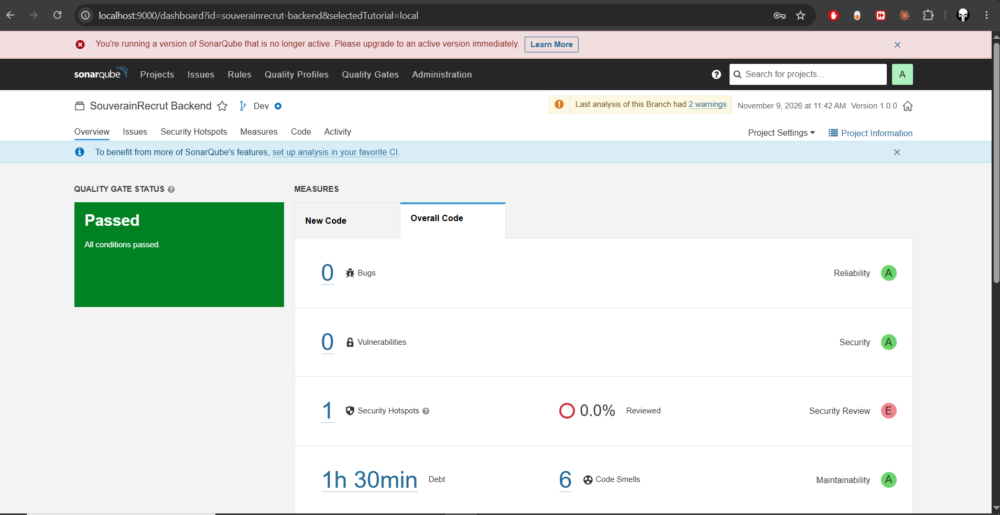

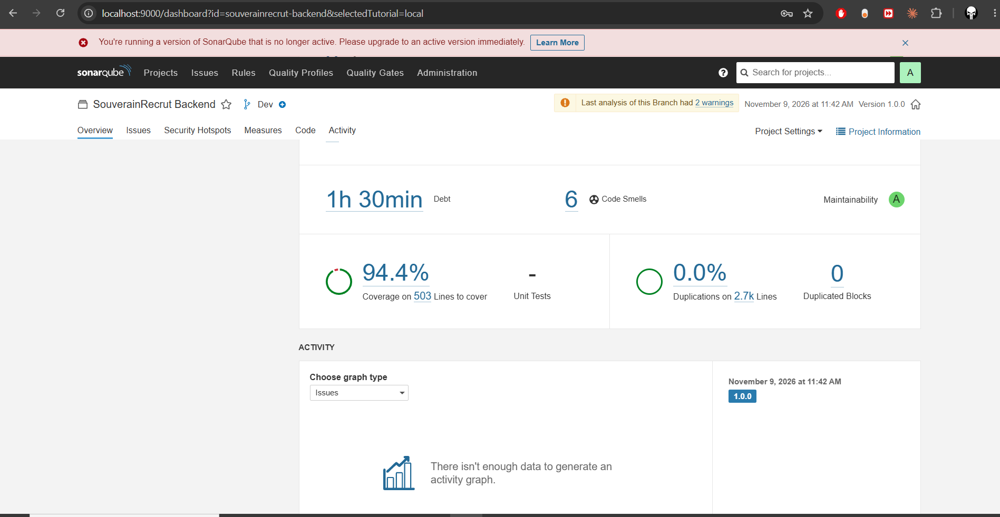

**Hotspot S5689** sur `const app = express()` : en-tête `X-Powered-By` révélant la technologie.

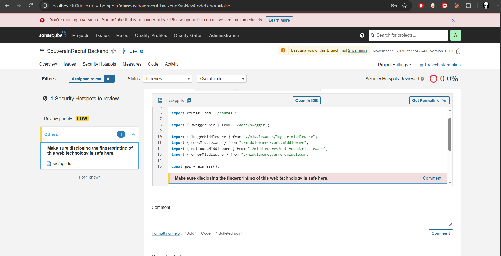

**Après correction** (`app.disable("x-powered-by")`) : plus aucun hotspot, Security Review A.

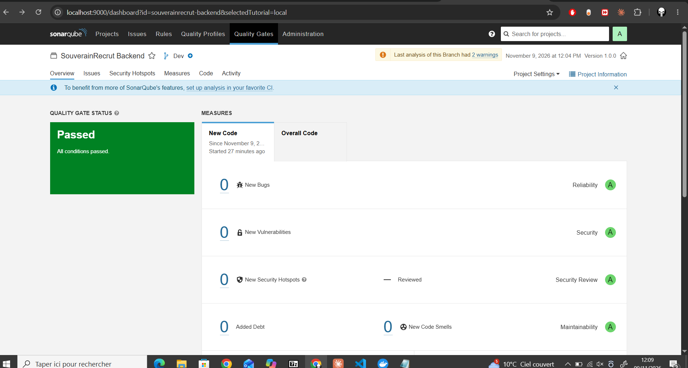

**Quality Gate « SouverainRecrut »** : conditions sur le code neuf, puis sur l'ensemble du code.

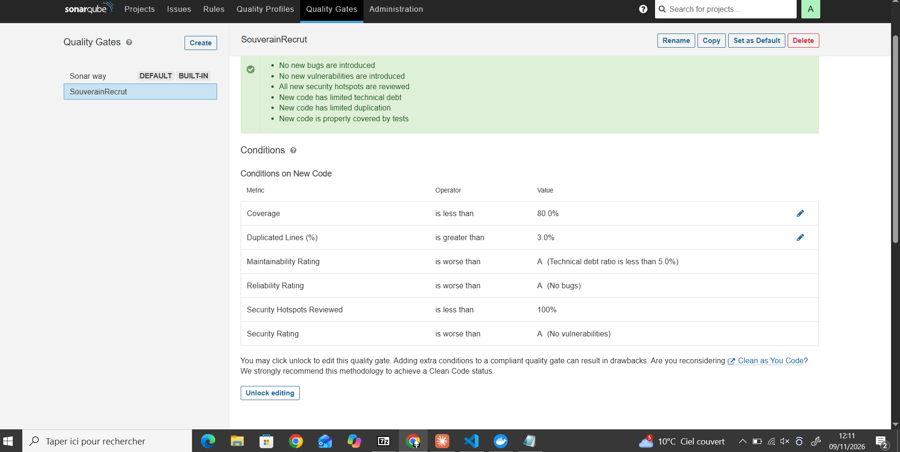

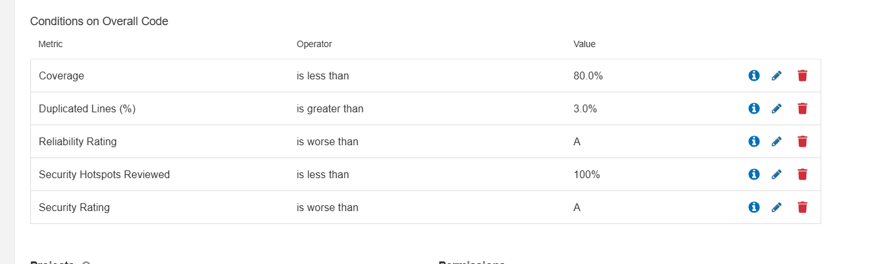

**Analyse finale** avec le gate personnalisé : Passed (le message confirme l'ajout de conditions).

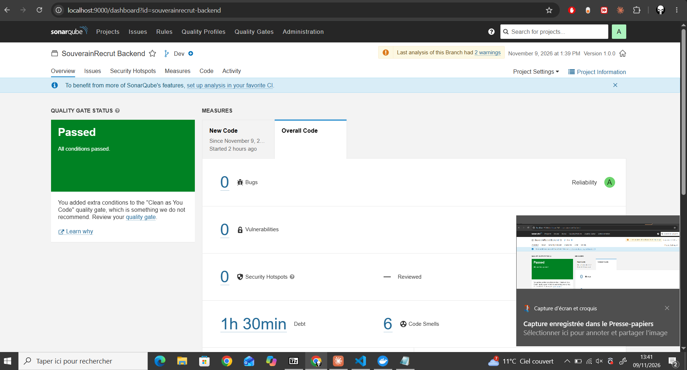

### 3.4 Jenkins
- Jenkins en conteneur, à partir d'une **image personnalisée** (`integration-continue/jenkins/Dockerfile`) contenant
  Node 22, Docker CLI, Trivy et les plugins (`plugins.txt`) : l'environnement de build est décrit
  en code et reconstructible.
- Accès au moteur Docker de l'hôte via le socket, avec ajout du seul groupe propriétaire
  (`group_add: "0"`) plutôt que d'exécuter Jenkins en root.
- Réseau Docker `cicd-net` partagé avec SonarQube (analyse dans un sens, webhook dans l'autre).
- **Credentials** : `sonar-token` (User Token dédié) et `dockerhub` (Personal Access Token
  Read & Write) ; aucun secret dans le dépôt.

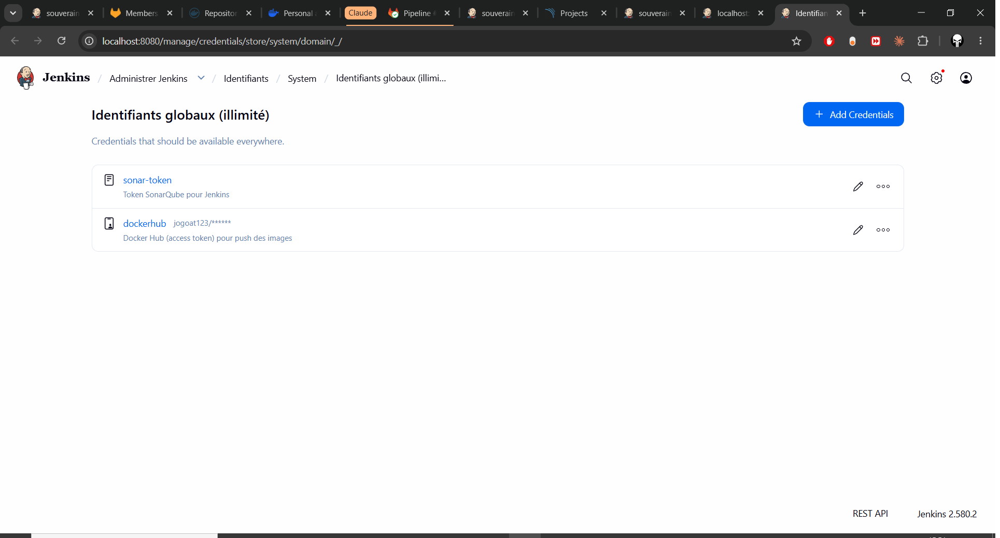

Webhook SonarQube vers Jenkins, dernière livraison en succès (résultat du Quality Gate renvoyé à la pipeline) :

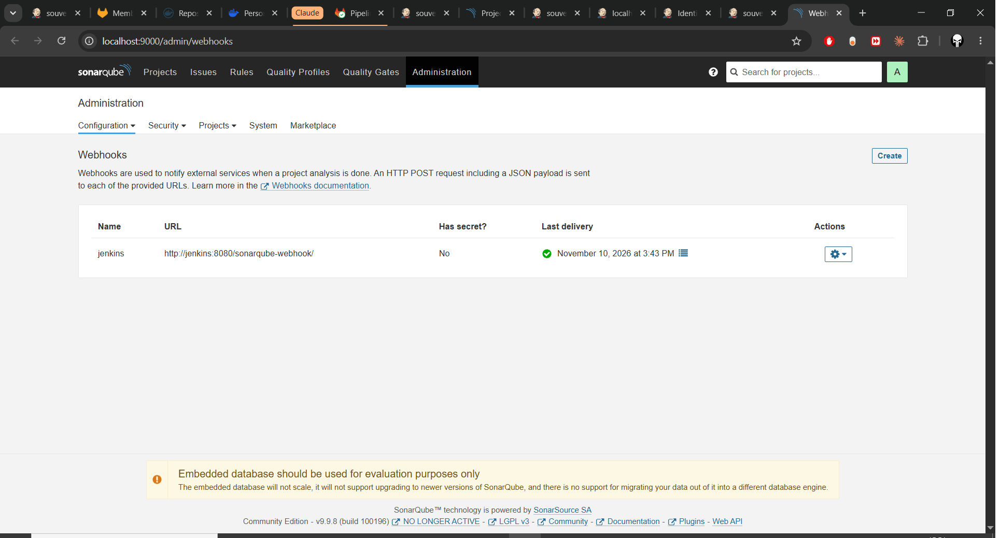

### 3.5 Pipeline (Jenkinsfile)
Checkout de `Dev` → `npm ci` → `prisma generate` → tests (JUnit + couverture) → analyse SonarQube →
**Quality Gate bloquant** → build de l'image → **Trivy bloquant** → push Docker Hub.
Déclenchement automatique toutes les 5 minutes en cas de nouveau commit (`pollSCM`).

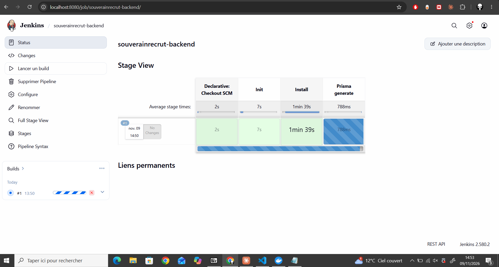

Build #1 arrêté à l'étape SonarQube (incident 8) : les étapes suivantes sont sautées et **aucune image
n'est publiée**. Build #2, après correction : toutes les étapes en succès, image publiée.

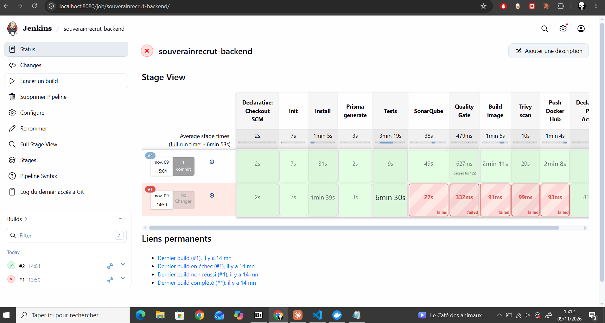

Page du job : Quality Gate SonarQube **Passed** remonté dans Jenkins, historique des 65 tests sur tous
les builds.

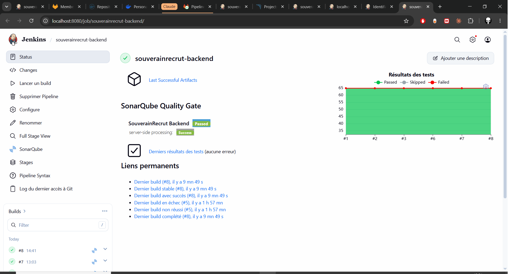

Résultats des tests publiés par Jenkins (rapport JUnit) : 65 tests, aucun échec.

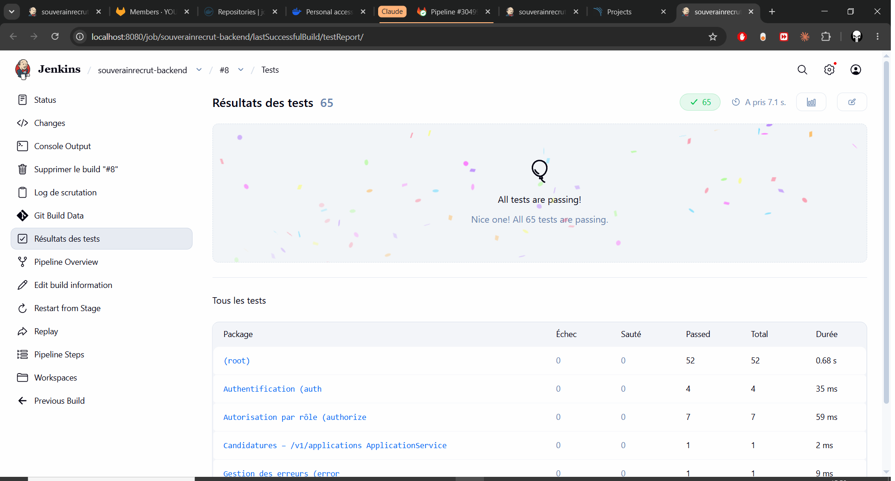

Rapport Trivy archivé par le build (image `1.1.0-4371f31`) :

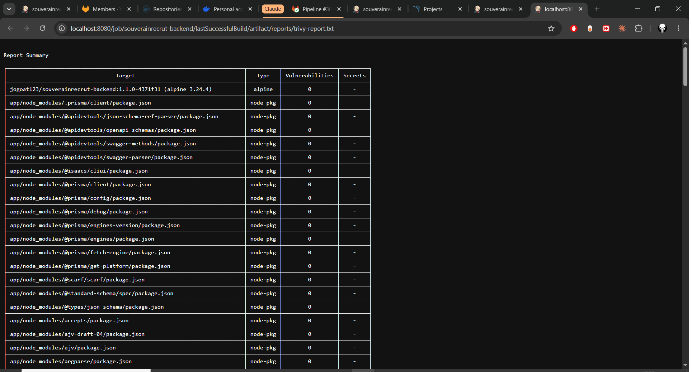

### 3.6 Image Docker et publication
Dockerfile du Backend revu :

| Problème | Correction |
|---|---|
| Node 20 (exigence : 22+) | `node:22-alpine` |
| Exécution en root | `USER node` |
| Pas de `.dockerignore` (risque d'embarquer `.env`) | `.dockerignore` créé |
| `COPY . .` | copies ciblées, meilleur cache |
| Pas de contrôle de santé | `HEALTHCHECK` sur `/v1/health` |
| Pas de traçabilité | labels OCI `version` / `revision` |
| npm présent à l'exécution | supprimé de l'image finale |

**Scan Trivy** : l'image initiale présentait **1 CRITICAL** (`proxy-addr`, usurpation d'adresse IP)
et 26 HIGH. Après mise à jour des dépendances transitives (sans changer les versions déclarées) et
suppression de npm de l'image : **0 CRITICAL, 2 HIGH**. Les 2 HIGH restants proviennent de versions
imposées par Prisma ; risque accepté et documenté, correction = montée de version de Prisma.

**Seuils** : CRITICAL corrigeable → bloquant ; HIGH → signalé dans le rapport archivé.

**Publication** : `jogoat123/souverainrecrut-backend:1.0.0-2d7e00c` – le tag associe la version
applicative (`1.0.0`) et le commit (`2d7e00c`). Après le correctif des migrations Prisma (incident 13),
le build #6 a publié **`1.0.0-fc7bb2c`**, version déployée en production.

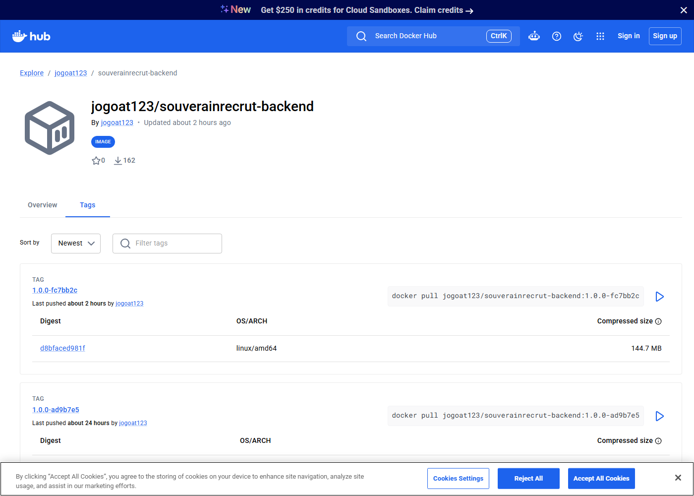

## 4. Résultats de la partie 1

| Exigence du cahier des charges | Résultat | Preuve |
|---|---|---|
| Jenkinsfile opérationnel | Build #2 vert de bout en bout (≈ 7 min) | capture 09, `reports/jenkins/build-2-console.txt` |
| Tests Backend exécutables | 65 / 65 | `reports/tests/` |
| Rapport de couverture | 100 % lignes (Jest), 94,4 % (SonarQube) | `reports/couverture/` |
| Résultats SonarQube | Quality Gate Passed | captures 01–07, `sonar/README.md` |
| Résultats Trivy | 0 CRITICAL, 2 HIGH | `reports/trivy/` |
| Image versionnée sur Docker Hub | `1.0.0-2d7e00c` | log du build #2, Docker Hub |
| Publication conditionnée | Build #1 en échec → **aucune image publiée** | capture 09 |

## 5. Sécurité de la chaîne

- **Secrets** : uniquement dans les credentials Jenkins ; injectés par `withCredentials`, passés
  par `--password-stdin`, masqués dans les logs. `.env` exclus de Git et de l'image.
- **Tokens à portée minimale** : token Docker Hub plutôt que mot de passe, User Token Sonar dédié.
- **Rotation** : un token SonarQube communiqué par erreur en clair a été considéré comme compromis,
  révoqué et remplacé.
- **Défense en profondeur** : tests de sécurité (JWT falsifié/expiré, rôles, absence de fuite
  d'erreur), analyse statique, scan de l'image, exécution non-root.

## 6. Incidents rencontrés et résolutions

| # | Incident | Diagnostic | Résolution |
|---|---|---|---|
| 1 | Premier test vide / route introuvable | Fichier non sauvegardé ; routes préfixées par `/${API_VERSION}` (`/v1`) | Test corrigé sur `/v1/health` |
| 2 | Avertissement ts-jest `TS151002` | Projet en `module: NodeNext` | `isolatedModules: true` dans `tsconfig.test.json` |
| 3 | Docker indisponible (`500 … dockerDesktopLinuxEngine`) | Mise à jour de Docker Desktop en cours | Attente de la fin de la mise à jour |
| 4 | Rapport Sonar non reçu (`unexpected end of stream`) | Envoi coupé via `host.docker.internal` ; SonarQube sain | Réseau Docker dédié `cicd-net` |
| 5 | `Condition Coverage` au lieu de `Coverage` dans le gate | Mauvaise métrique (branches seules, 68 %) | Condition remplacée avant l'analyse |
| 6 | Token SonarQube exposé | Collé dans un échange en clair | Révocation et remplacement |
| 7 | Échec ponctuel de `npm ci` au build Docker | Erreur réseau passagère | Build relancé à l'identique : succès |
| 8 | Build #1 : `Failed to query server version` | SonarQube **tué par manque de mémoire** (`OOMKilled`) pendant les tests : Jest lançait 15 processus (16 cœurs) sur ≈ 2,8 Go | Jest à 2 workers, Jenkins `-Xmx768m`, SonarQube en redémarrage automatique. Tests : 6 min 30 → 9 s |
| 9 | ESXi : *« Virtualized AMD-V/RVI is not supported »* | Virtualisation activée dans le BIOS, mais Hyper-V actif (Docker Desktop, VBS) : pas de virtualisation imbriquée ; ESXi exige 8 Go de RAM | VM Ubuntu créée directement dans VMware Workstation (cas prévu au §4.2) |
| 10 | Docker Desktop ne démarre plus (`HCS/ERROR_NO_SYSTEM_RESOURCES`) | 0,9 Go de RAM libre | CI et déploiement utilisés en alternance ; VM à 2 Go |
| 11 | WSL indisponible pour Ansible | même cause mémoire | VM utilisée comme poste de contrôle, Ansible reste en SSH |
| 12 | Disque de la VM à 14 Go au lieu de 30 | partitionnement LVM par défaut d'Ubuntu (moitié du disque) | `lvextend -r -l +100%FREE` → 28 Go |
| 13 | Migrations impossibles dans l'image : `Can't write to node_modules/@prisma/engines` | moteur Prisma non téléchargé (`--ignore-scripts`), `node_modules` non modifiable par l'utilisateur non-root | Dockerfile : copie de `@prisma/engines` depuis l'étape builder ; validé sur le serveur (5 tables créées) |
| 14 | `.gitlab-ci.yml` refusé par l'éditeur (*Expected string*) | `Tag invalide : …` : « deux-points espace » interprété comme une clé YAML | message reformulé ; contrôle automatique que chaque ligne de script est une chaîne |
| 15 | Docker Desktop ne redémarre pas après utilisation de la VM (*terminated unexpectedly*) | machine virtuelle WSL (`vmmem`) restée bloquée ; WSL refusait de démarrer même plafonné à 1,5 Go alors que 12 Go de mémoire virtuelle étaient libres | `wsl --shutdown` puis `docker desktop start` (1re fois : redémarrage de Windows) ; `.wslconfig` : `memory=2560MB`, `swap=4GB` ; ajouté au runbook |
| 16 | Builds Jenkins #4 et #5 : `Unable to find Jenkinsfile` | Jenkinsfile déplacé dans `integration-continue/` avant la mise à jour du job | Script Path du job modifié ; aucun impact (rien publié) |
| 17 | `git push` vers GitLab : *HTTP Basic: Access denied* | GitLab n'accepte pas le mot de passe du compte pour Git en HTTPS | Personal Access Token `write_repository` |
| 18 | Script de vérification interrompu après la 1re commande | `docker compose exec` lisait la suite du script envoyée sur l'entrée standard | exécution depuis un fichier, `< /dev/null` |

L'incident 8 illustre le rôle de la pipeline : l'échec a stoppé la chaîne **avant** la publication ;
aucune image non contrôlée n'a atteint Docker Hub. L'incident 13 illustre l'intérêt de tester en
conditions réelles (« Manuel » avant « Automatisé ») : il a été détecté avant le premier déploiement.

## 7. Partie 2 – Provisionnement et déploiement

### 7.1 Environnement VMware (§4.1)
- VM `souverainrecrut-srv` dans **VMware Workstation 17.6.4** : Ubuntu Server **24.04.5 LTS**, 2 vCPU,
  2 Go RAM, 30 Go, réseau NAT, IP `192.168.13.129`.
- L'ISO fourni (Ubuntu 22.04 *Desktop*) n'étant pas conforme, l'ISO officiel Server 24.04.3 a été utilisé.
- SSH vérifié depuis Windows, accès Internet vérifié, système mis à jour, disque étendu à 28 Go.
- Clé SSH **dédiée** au déploiement (ed25519), créée sur le poste, droits restreints, authentification
  sans mot de passe vérifiée.
- Snapshot `01-ubuntu-installe-a-jour` pris **avant** toute configuration :
  ```
  > vmrun listSnapshots souverainrecrut-srv.vmx
  Total snapshots: 1
  01-ubuntu-installe-a-jour
  ```
- ESXi abandonné (incident 9) : justification technique dans [`architecture.md`](architecture.md).

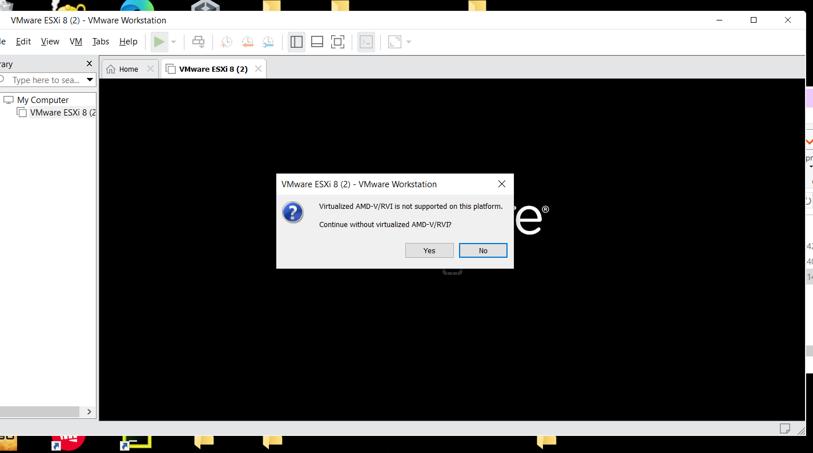

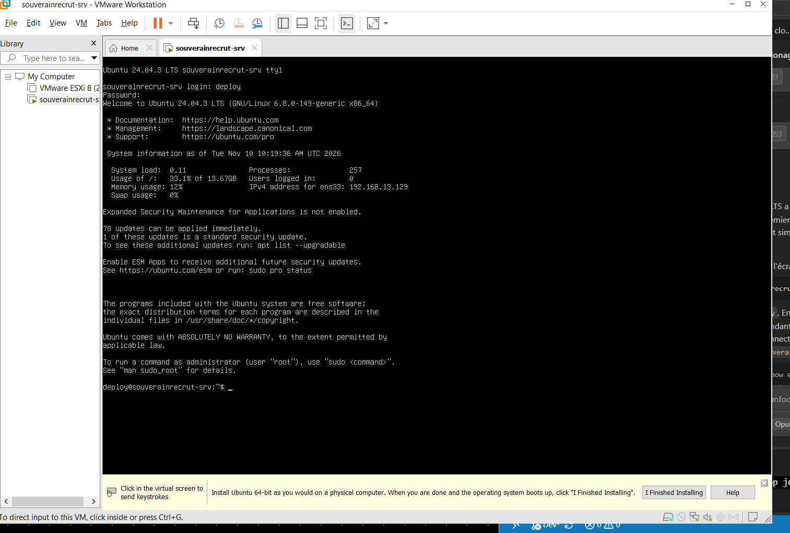

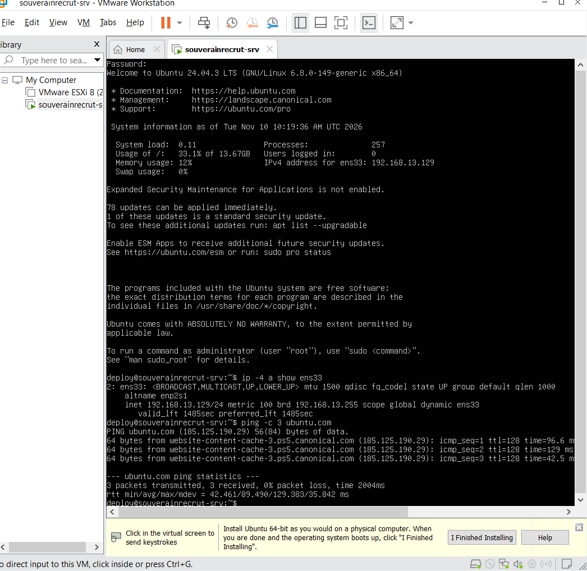

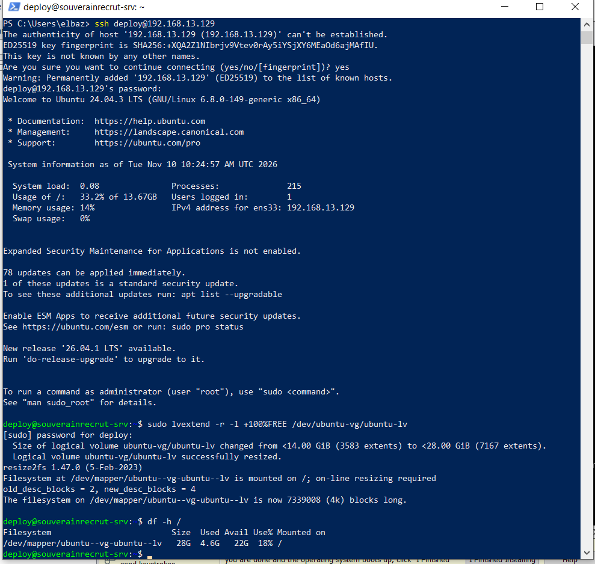

### 7.2 Terraform (§4.2)
Faute d'ESXi/vCenter, Terraform est appliqué aux ressources disponibles : `providers.tf`,
`variables.tf`, `main.tf`, `outputs.tf`. Il décrit le serveur (IP validée, utilisateur, répertoire,
caractéristiques de la VM) et **génère l'inventaire Ansible** : l'adresse du serveur n'est saisie qu'une
fois. `init` → `validate` → `plan` (2 ressources) → `apply`. Lockfile du provider versionné.

### 7.3 Ansible (§4.3)
Playbook idempotent : mise à jour du système, **Docker Engine et plugin Compose** depuis le dépôt
officiel, service activé, utilisateur `deploy` dans le groupe `docker`, répertoire
`/opt/souverainrecrut`, pare-feu UFW (22 et 4000, SSH autorisé avant activation), vérifications.
Résultat : `ok=18 changed=7 failed=0` ; Docker 29.9.3 actif, Compose 5.7.0.

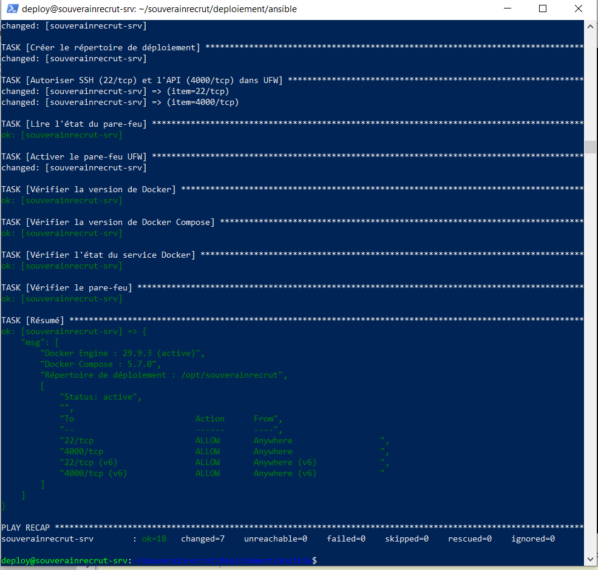

### 7.4 Docker Compose (§5.2)
Services `db` (PostgreSQL 16, volume persistant, non exposé), `migrate` (`prisma migrate deploy`,
exécution unique) et `api` (image Docker Hub, démarre seulement si les migrations ont réussi),
healthchecks et redémarrage automatique. Variables obligatoires contrôlées ; `.env.example` versionné,
`.env` réel jamais versionné.

Test réalisé sur le serveur : `db` et `api` *healthy*, `migrate` *Exited (0)*, `/v1/health` → `UP`,
`/v1/ready` → `CONNECTED` ; API joignable depuis le poste, PostgreSQL non joignable.

### 7.5 Pipeline GitLab CI/CD (§4.4, §5.1, §5.3)
Projet GitLab dédié au déploiement. Jobs : `validate-tag` (format `version-commit` et existence sur
Docker Hub), `deploy-production` (**approbation manuelle** ; SSH ; Compose ; `.env` généré depuis des
variables masquées ; sauvegarde `pg_dump` ; `docker login --password-stdin` ; `pull` ; `up -d` ;
historique), `verify-deployment` (état *healthy*, `/v1/health`, `/v1/ready`, tag effectivement en
service), `rollback-production` (manuel). Runner local sur le serveur, celui-ci étant sur un réseau
privé. L'image n'est jamais reconstruite.

**Mise en œuvre** :
- projet GitLab `souverainrecrut-deploiement` alimenté par `git subtree push --prefix deploiement`
  (le dossier `deploiement/` du dépôt principal devient la racine du projet GitLab) ;
- runner GitLab 19.5.3 installé sur le serveur (exécuteur Docker, tag `souverainrecrut`), jeton saisi
  sans affichage (`read -rs`), configuration lisible par root uniquement ;
- 9 variables CI/CD (clé SSH et `known_hosts` en type *File*, token Docker Hub en lecture seule,
  mot de passe PostgreSQL et secret JWT générés par `openssl rand` et masqués).

**Premier déploiement – pipeline #3049956923 (10/11/2026)** :
| Job | Résultat |
|---|---|
| `validate-tag` | ✅ `1.0.0-fc7bb2c` au bon format et présent sur Docker Hub |
| `deploy-production` | ✅ après approbation manuelle |
| `verify-deployment` | ✅ API *healthy*, `/v1/ready` = `CONNECTED`, bon tag en service |

État constaté sur le serveur : `api` (`1.0.0-fc7bb2c`) et `db` *healthy*, `migrate` *Exited (0)*,
`.env` en 600, `backups/` en 700, historique :
`2026-11-10T14:04:44Z 1.0.0-fc7bb2c pipeline=3049956923 par=elbazyoussef8`.

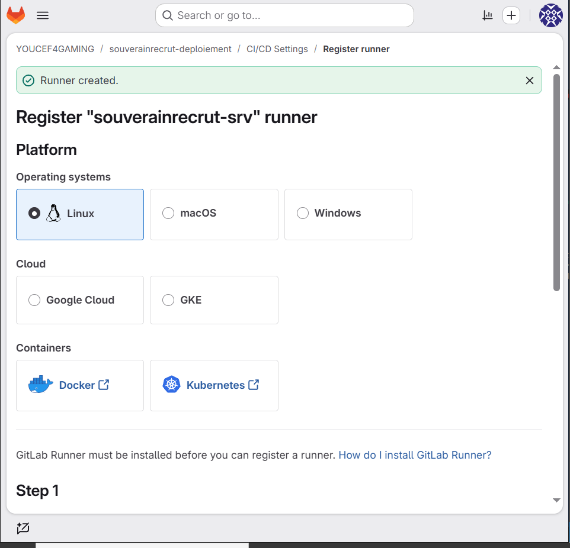

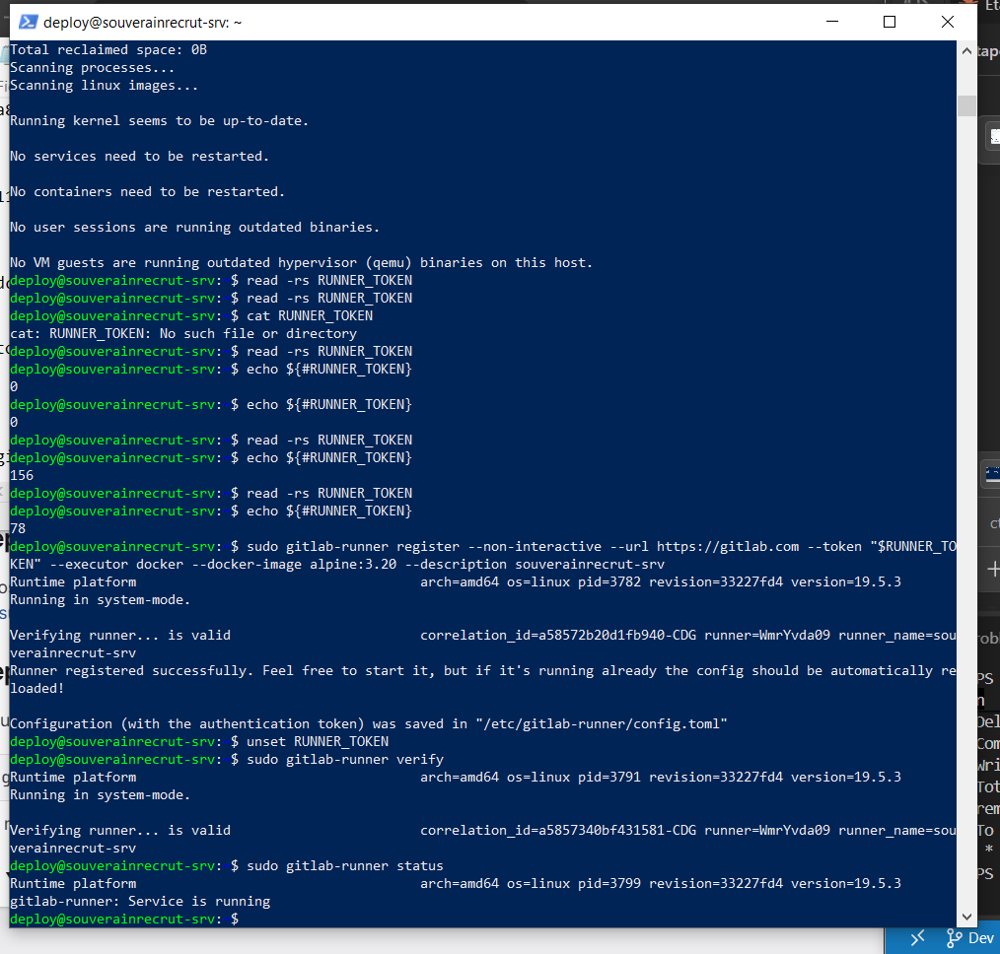

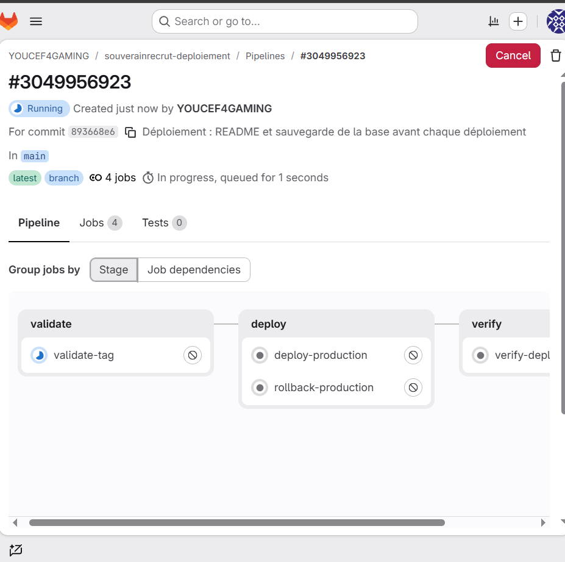

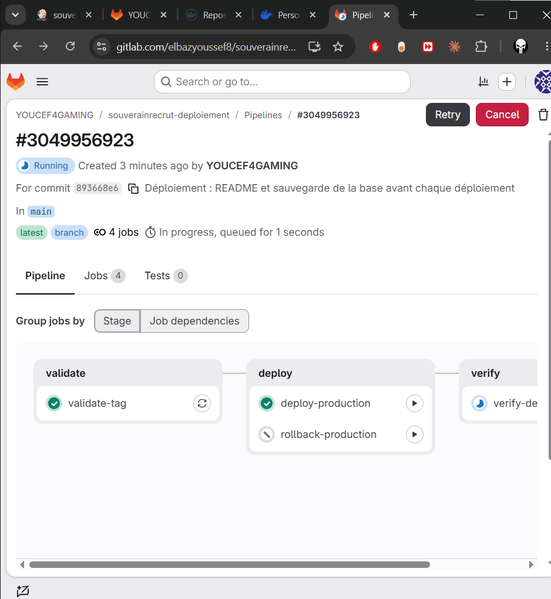

Pipeline terminé : validation, déploiement et vérification en succès.

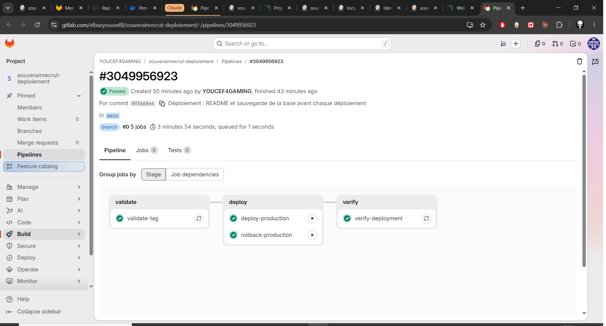

Variables CI/CD : secrets masqués, variables protégées, clé SSH et `known_hosts` en type *File*.

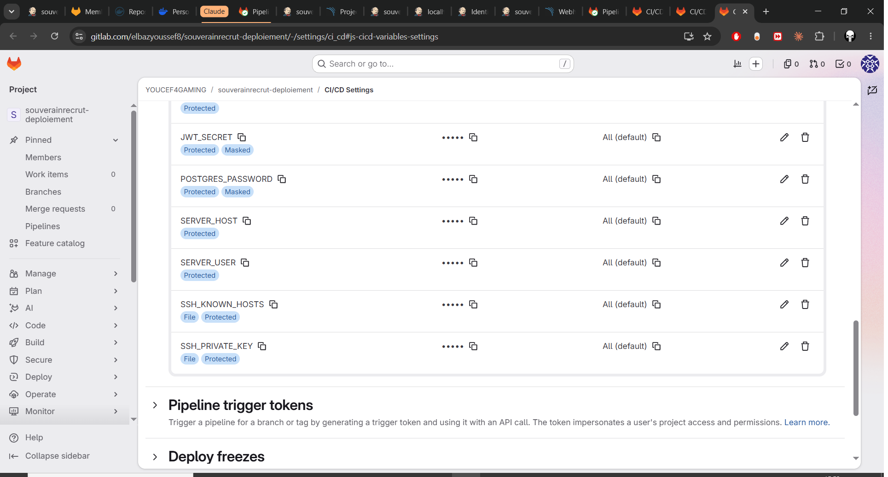

### 7.6 Vérification et rollback (§5.4)
Procédure : [`procedure-rollback.md`](procedure-rollback.md). Version précédente identifiée par
l'historique `deploy-history.log` et les tags Docker Hub ; retour arrière par le job
`rollback-production` ou manuellement ; sauvegarde de la base avant chaque déploiement, migrations
rétrocompatibles (le rollback de l'image ne défait pas le schéma).

**Vérification fonctionnelle de l'API déployée** (script `deploiement/scripts/verifier-api.sh`) :

| Contrôle | Résultat |
|---|---|
| `GET /health`, `/ready`, `/info` | `UP`, `CONNECTED`, `SouverainRecrut API v1.0.0 (production)` |
| Connexion administrateur | JWT reçu, mot de passe absent de la réponse ; mauvais mot de passe → 401 |
| Contrôle d'accès | sans token → 401, token falsifié → 401 |
| Candidats | création (email normalisé), doublon → 409, données invalides → 400, inconnu → 404 |
| Offres, candidatures | création, passage de la candidature au statut `ACCEPTED` |
| Tableau de bord | `users 1, candidates 1, jobs 1, applications 1` |
| **Persistance** | `docker compose down` puis `up` (volume conservé) : 1 candidat avant, 1 après |

La pile redémarre aussi automatiquement après un redémarrage de la VM (`restart: unless-stopped`).

*[à compléter : résultats du scénario de rollback version A → version B → retour à A]*

## 8. Conformité aux exigences de qualité et de sécurité (§7)

| Exigence | Statut | Éléments |
|---|---|---|
| Reproductibilité | ✅ | `integration-continue/README.md`, `procedure-deploiement.md` ; Jenkins, Terraform, Ansible, Compose et pipelines en code |
| Qualité logicielle | ✅ | Tests exécutés à chaque build, couverture et SonarQube consultables |
| Sécurité | ✅ | Secrets en credentials Jenkins / variables GitLab masquées, image scannée par Trivy, pare-feu, base non exposée, clé SSH dédiée |
| Traçabilité | ✅ | Tag `<version>-<commit>`, labels OCI, logs de build archivés, `deploy-history.log` |
| Déploiement | ✅ testé / ⏳ via GitLab | Serveur récupère l'image et l'API démarre avec PostgreSQL (test Compose) ; exécution GitLab à compléter |
| Continuité (rollback) | ✅ documenté / ⏳ testé | `procedure-rollback.md`, job `rollback-production`, sauvegarde avant déploiement |
| Documentation | ✅ | README CI et déploiement, architecture, procédures, runbooks, ce rapport |

## 9. Limites et pistes d'amélioration
- Monter de version Prisma pour supprimer les 2 vulnérabilités HIGH restantes.
- Ajouter une validation Zod sur `POST /auth/login` (seule route sans schéma).
- Traiter les 6 code smells SonarQube ; migrer vers une version active de SonarQube.
- Ajouter des scanners complémentaires vus en cours : `gitleaks` (secrets dans Git), `npm audit`.
- Exposer Jenkins (tunnel) pour remplacer le `pollSCM` par un webhook GitHub instantané.

## Annexe A – Historique Git (branche `Dev`)

| Commit | Contenu |
|---|---|
| `28f6d56` | Mise en place de Jest |
| `810164c` | 64 tests Backend (mock Prisma) |
| `0b9185f` | Configuration SonarQube, correction du hotspot `X-Powered-By` |
| `9b39b01` | Image Jenkins (Dockerfile, plugins, docker-compose) |
| `03eeb89` | Jenkinsfile, Dockerfile Backend sécurisé, rapport JUnit |
| `2d7e00c` | Limites mémoire (Jest, Jenkins) – build #2 vert, image publiée |
| `ad9b7e5` | Livrables partie CI (documentation, rapports) |
| `b79d890` … `95dc8f4` | Partie déploiement : `.gitignore`, correctif migrations Prisma, captures VM, Terraform, Ansible, Docker Compose, GitLab CI |

## Annexe B – Organisation du livrable

Conforme à l'organisation du §6 du cahier des charges :

```
integration-continue/
├── Jenkinsfile                  pipeline CI (Script Path du job Jenkins)
├── Dockerfile                   image de l'API (contexte de build : backend/)
├── sonar/                       sonar-project.properties, Quality Gate, résultats
├── reports/                     tests, couverture, Trivy, logs Jenkins
├── jenkins/                     image et lancement de Jenkins
└── README.md                    documentation du pipeline + runbook
deploiement/
├── terraform/                   providers.tf, variables.tf, main.tf, outputs.tf
├── ansible/                     inventory.ini, playbook.yml, ansible.cfg
├── deployment/
│   ├── docker-compose.yml
│   └── .env.example
├── .gitlab-ci.yml
└── README.md
documentation/
├── architecture.md
├── procedure-deploiement.md
├── procedure-rollback.md
├── rapport-final.md             ce document
└── captures/                    captures d'écran
backend/                         code de l'API, tests, .dockerignore
```
Exclus du dépôt : `.env` réels, `terraform.tfvars`, états Terraform, clés privées, tokens, ISO.
